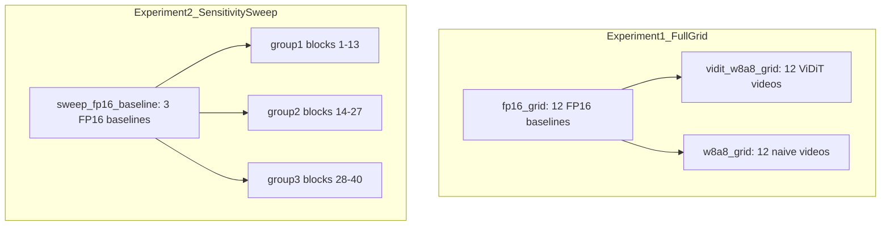

# DynamiCtrl PTQ — Kinematic Gate Experiment Report

Complete results from the W8A8 quantization experiments and kinematic delta gate evaluations. This document is self-contained: methodology, thresholds, every clip result, and side-by-side comparisons for clips that appear in both the full grid and sensitivity sweep.

**Source notebook:** `notebooks/DynamiCtrl-PTQ-ViDiT.ipynb`  
**Method doc:** `docs/DynamiCtrl-PTQ-method.md`  
**Human2 cross-experiment comparison:** `docs/DynamiCtrl-PTQ-human2-kinematic-gate-comparison.md`  
**Config:** `configs/quant/vidit_ptq.json` (seed 42)

---

## 1. Introduction and goals

We applied post-training W8A8 quantization to DynamiCtrl-5B's DiT backbone using two algorithms, then evaluated generated videos with an automatic **kinematic gate** — pose metrics extracted from output video (OpenPose + MediaPipe + Kalman) compared against FP16 baseline. Kinematics is used only as a pass/fail acceptance test, not as a training signal.

Two experiments were run:

1. **Full grid (Experiment 1):** Quantize the full model once per algorithm, generate **12 videos** (4 reference images × 3 driving motions), gate each against FP16.
2. **Sensitivity sweep (Experiment 2):** Quantize **one block group at a time** (rest of DiT stays FP16), generate **3 videos** (`human2` × 3 motions) per group per algorithm — **9 videos per algorithm**, **18 total per algorithm** across 3 groups × 2 algos.

---

## 2. Two quantization algorithms

| Algorithm | Notebook cell | Output directory | Video filename pattern |
|-----------|---------------|------------------|------------------------|
| **ViDiT-Q W8A8** | Batch cell 3 | `outputs/vidit_w8a8_grid/` | `vidit_w8a8_{clip}_seed42.mp4` |
| **Matched naive W8A8** | Batch cell 4 | `outputs/w8a8_grid/` | `w8a8_{clip}_seed42.mp4` |

**ViDiT-Q** applies SmoothQuant folding plus per-clip calibration; ~24 layers identified as timestep-sensitive stay in FP16 across all blocks (`early_sensitivity_ratio=1.25`, `max_early_fp16_layers=24`).

**Matched naive W8A8** uses the same calib-selected FP16 skip list but **no SmoothQuant** — a fair baseline to isolate ViDiT's benefit.

In the sensitivity sweep, ViDiT uses `apply_vidit_w8a8` with `actual_int8_layers` restricted to the target block group; naive uses `apply_w8a8` with `fp16_layers` = all layers outside that group.

---

## 3. Experiment designs



### Experiment 1 — Full grid

| Item | Value |
|------|-------|
| Clips | 4 humans × 3 motions = **12** |
| FP16 baseline | `outputs/fp16_grid/` (Batch cell 1) |
| Quantization | Full model W8A8 + calib FP16 skip (~24 layers) |
| Videos per algorithm | **12** |
| Gate logs (ViDiT) | `logs/kinematic_gate_grid/` |
| Gate logs (naive) | `logs/kinematic_gate_w8a8_grid/` |

### Experiment 2 — Sensitivity sweep

| Item | Value |
|------|-------|
| Clips | `human2_motion1`, `human2_motion2`, `human2_motion3` only |
| FP16 baseline | `outputs/sweep_fp16_baseline/` (separate mini baseline) |
| Block groups | group1: blocks 1–13, group2: 14–27, group3: 28–40 |
| Quantization | Only target group → INT8; rest stays FP16 |
| Videos per group per algorithm | **3** |
| Total per algorithm | 3 groups × 3 clips = **9** |
| Output dirs | `outputs/sweep_group{N}_{naive,vidit}/` |

---

## 4. Kinematic gate — how to read results

Gate script: `scripts/quant/kinematic_gate/run_grid_kinematic_gate.py` (full grid) and `run_kinematic_gate.py` (per-clip / sweep naive).

### Pipeline

1. Extract poses from FP16 and quantized MP4 (OpenPose + MediaPipe + Kalman via phase1).  
2. Compute kinematic metric vector on each video.  
3. Compare **deltas** (quant vs FP16).  
4. **Pass** only if every check is within tolerance.

### Gate thresholds (`configs/quant/vidit_ptq.json` → `kinematic_gate`)

| Check | Threshold | Meaning |
|-------|-----------|---------|
| acceleration_variance | rel delta ≤ **0.10** | Temporal smoothness of joint motion |
| mean_limb_length_std | rel delta ≤ **0.10** | Limb length stability across frames |
| var_accel_norm (jitter) | rel delta ≤ **0.15** | Normalized acceleration jitter |
| violation_fraction | quant ≤ FP16 + **0.02** | No new biomechanical constraint breaks |
| mean_NPE | ≤ **0.15** | Mean normalized pose error vs FP16 skeleton |
| p95_NPE | ≤ **0.30** | 95th-percentile pose error |
| under_motion_violations | ≤ **0.0** | Frames under-moving vs driving motion |

**Note:** A clip can fail even when acceleration delta is small — e.g. new constraint violations or high pose error (`human4` clips often fail on `p95_NPE`).

---

## 5. Executive summary

| Run | ViDiT pass | Naive pass |
|-----|------------|------------|
| Full grid (12 clips) | **2/12** | **5/12** |
| Sweep group1 (blocks 1–13) | **1/3** | **2/3** |
| Sweep group2 (blocks 14–27) | **2/3** | **2/3** |
| Sweep group3 (blocks 28–40) | **1/3** | **1/3** |
| Sweep total (9 per algo) | **4/9** | **5/9** |

### Key findings

- **Matched naive W8A8 beats ViDiT-Q on the full 12-clip grid** (5/12 vs 2/12 passes).
- **Early blocks (group1, 1–13) are most kinematically sensitive** in the sweep — highest acceleration deltas when isolated to INT8.
- **`human2_motion1` is the hardest clip** — fails most full-grid and sweep runs.
- **`human4_*` clips fail both algorithms on the full grid** — mainly high `p95_NPE` and kinematic deltas.
- **Only `human3_motion2` passes both ViDiT and naive** on the full grid.

---

## 6. Experiment 1 — Full grid results

### 6a. Pass/fail matrix (12 clips)

| Clip | ViDiT | Naive |
|------|-------|-------|
| `human1_motion1` | FAIL | FAIL |
| `human1_motion2` | FAIL | FAIL |
| `human1_motion3` | PASS | FAIL |
| `human2_motion1` | FAIL | FAIL |
| `human2_motion2` | FAIL | PASS |
| `human2_motion3` | FAIL | PASS |
| `human3_motion1` | FAIL | PASS |
| `human3_motion2` | PASS | PASS |
| `human3_motion3` | FAIL | PASS |
| `human4_motion1` | FAIL | FAIL |
| `human4_motion2` | FAIL | FAIL |
| `human4_motion3` | FAIL | FAIL |

**ViDiT passed:** `human1_motion3`, `human3_motion2`

**Naive passed:** `human2_motion2`, `human2_motion3`, `human3_motion1`, `human3_motion2`, `human3_motion3`

### 6b. Per-clip detail (all 12 clips × 2 algorithms)

### `human1_motion1`

#### Full grid — ViDiT-Q W8A8 — **FAIL**

- **FP16 video:** `outputs/fp16_grid/human1_motion1/fp16_human1_motion1_seed42.mp4`
- **Quant video:** `outputs/vidit_w8a8_grid/human1_motion1/vidit_w8a8_human1_motion1_seed42.mp4`

| Metric | FP16 | Quant | Delta |
|--------|------|-------|-------|
| acceleration_variance | 441.91 | 356.12 | rel=0.1941 |
| mean_limb_length_std | 148.82 | 133.44 | rel=0.1034 |
| var_accel_norm (jitter) | 425.42 | 339.14 | rel=0.2028 |
| violation_fraction | 0.676 | 0.541 | abs=0.135 |
| total_violations | 29 | 24 | abs=5 |
| mean_NPE | — | — | 0.0112 |
| p95_NPE | — | — | 0.0302 |
| under_motion_violations | — | — | 0 |

**Failed checks:** acceleration_variance, mean_limb_length_std, var_accel_norm

#### Full grid — Matched naive W8A8 — **FAIL**

- **FP16 video:** `outputs/fp16_grid/human1_motion1/fp16_human1_motion1_seed42.mp4`
- **Quant video:** `outputs/w8a8_grid/human1_motion1/w8a8_human1_motion1_seed42.mp4`

| Metric | FP16 | Quant | Delta |
|--------|------|-------|-------|
| acceleration_variance | 441.91 | 349.98 | rel=0.2080 |
| mean_limb_length_std | 148.82 | 145.12 | rel=0.0249 |
| var_accel_norm (jitter) | 425.42 | 339.91 | rel=0.2010 |
| violation_fraction | 0.676 | 0.757 | abs=0.081 |
| total_violations | 29 | 32 | abs=3 |
| mean_NPE | — | — | 0.0079 |
| p95_NPE | — | — | 0.0178 |
| under_motion_violations | — | — | 0 |

**Failed checks:** acceleration_variance, var_accel_norm, violation_fraction

### `human1_motion2`

#### Full grid — ViDiT-Q W8A8 — **FAIL**

- **FP16 video:** `outputs/fp16_grid/human1_motion2/fp16_human1_motion2_seed42.mp4`
- **Quant video:** `outputs/vidit_w8a8_grid/human1_motion2/vidit_w8a8_human1_motion2_seed42.mp4`

| Metric | FP16 | Quant | Delta |
|--------|------|-------|-------|
| acceleration_variance | 375.48 | 225.92 | rel=0.3983 |
| mean_limb_length_std | 119.37 | 121.81 | rel=0.0204 |
| var_accel_norm (jitter) | 429.75 | 254.97 | rel=0.4067 |
| violation_fraction | 0.081 | 0.108 | abs=0.027 |
| total_violations | 3 | 4 | abs=1 |
| mean_NPE | — | — | 0.0163 |
| p95_NPE | — | — | 0.0649 |
| under_motion_violations | — | — | 0 |

**Failed checks:** acceleration_variance, var_accel_norm, violation_fraction

#### Full grid — Matched naive W8A8 — **FAIL**

- **FP16 video:** `outputs/fp16_grid/human1_motion2/fp16_human1_motion2_seed42.mp4`
- **Quant video:** `outputs/w8a8_grid/human1_motion2/w8a8_human1_motion2_seed42.mp4`

| Metric | FP16 | Quant | Delta |
|--------|------|-------|-------|
| acceleration_variance | 375.48 | 444.00 | rel=0.1825 |
| mean_limb_length_std | 119.37 | 120.87 | rel=0.0126 |
| var_accel_norm (jitter) | 429.75 | 462.00 | rel=0.0751 |
| violation_fraction | 0.081 | 0.081 | abs=0.000 |
| total_violations | 3 | 3 | abs=0 |
| mean_NPE | — | — | 0.0128 |
| p95_NPE | — | — | 0.0424 |
| under_motion_violations | — | — | 0 |

**Failed checks:** acceleration_variance

### `human1_motion3`

#### Full grid — ViDiT-Q W8A8 — **PASS**

- **FP16 video:** `outputs/fp16_grid/human1_motion3/fp16_human1_motion3_seed42.mp4`
- **Quant video:** `outputs/vidit_w8a8_grid/human1_motion3/vidit_w8a8_human1_motion3_seed42.mp4`

| Metric | FP16 | Quant | Delta |
|--------|------|-------|-------|
| acceleration_variance | 362.63 | 394.10 | rel=0.0868 |
| mean_limb_length_std | 81.70 | 89.28 | rel=0.0928 |
| var_accel_norm (jitter) | 292.87 | 332.41 | rel=0.1350 |
| violation_fraction | 0.108 | 0.081 | abs=0.027 |
| total_violations | 5 | 5 | abs=0 |
| mean_NPE | — | — | 0.0118 |
| p95_NPE | — | — | 0.0290 |
| under_motion_violations | — | — | 0 |

**Failed checks:** *(none)*

#### Full grid — Matched naive W8A8 — **FAIL**

- **FP16 video:** `outputs/fp16_grid/human1_motion3/fp16_human1_motion3_seed42.mp4`
- **Quant video:** `outputs/w8a8_grid/human1_motion3/w8a8_human1_motion3_seed42.mp4`

| Metric | FP16 | Quant | Delta |
|--------|------|-------|-------|
| acceleration_variance | 362.63 | 503.82 | rel=0.3893 |
| mean_limb_length_std | 81.70 | 87.63 | rel=0.0726 |
| var_accel_norm (jitter) | 292.87 | 432.01 | rel=0.4751 |
| violation_fraction | 0.108 | 0.081 | abs=0.027 |
| total_violations | 5 | 3 | abs=2 |
| mean_NPE | — | — | 0.0143 |
| p95_NPE | — | — | 0.0336 |
| under_motion_violations | — | — | 0 |

**Failed checks:** acceleration_variance, var_accel_norm

### `human2_motion1`

#### Full grid — ViDiT-Q W8A8 — **FAIL**

- **FP16 video:** `outputs/fp16_grid/human2_motion1/fp16_human2_motion1_seed42.mp4`
- **Quant video:** `outputs/vidit_w8a8_grid/human2_motion1/vidit_w8a8_human2_motion1_seed42.mp4`

| Metric | FP16 | Quant | Delta |
|--------|------|-------|-------|
| acceleration_variance | 172.61 | 224.09 | rel=0.2983 |
| mean_limb_length_std | 15.26 | 15.57 | rel=0.0200 |
| var_accel_norm (jitter) | 158.30 | 215.20 | rel=0.3595 |
| violation_fraction | 0.000 | 0.027 | abs=0.027 |
| total_violations | 0 | 1 | abs=1 |
| mean_NPE | — | — | 0.0139 |
| p95_NPE | — | — | 0.0384 |
| under_motion_violations | — | — | 0 |

**Failed checks:** acceleration_variance, var_accel_norm, violation_fraction

#### Full grid — Matched naive W8A8 — **FAIL**

- **FP16 video:** `outputs/fp16_grid/human2_motion1/fp16_human2_motion1_seed42.mp4`
- **Quant video:** `outputs/w8a8_grid/human2_motion1/w8a8_human2_motion1_seed42.mp4`

| Metric | FP16 | Quant | Delta |
|--------|------|-------|-------|
| acceleration_variance | 172.61 | 167.47 | rel=0.0298 |
| mean_limb_length_std | 15.26 | 14.91 | rel=0.0228 |
| var_accel_norm (jitter) | 158.30 | 153.52 | rel=0.0302 |
| violation_fraction | 0.000 | 0.081 | abs=0.081 |
| total_violations | 0 | 3 | abs=3 |
| mean_NPE | — | — | 0.0122 |
| p95_NPE | — | — | 0.0319 |
| under_motion_violations | — | — | 0 |

**Failed checks:** violation_fraction

### `human2_motion2`

#### Full grid — ViDiT-Q W8A8 — **FAIL**

- **FP16 video:** `outputs/fp16_grid/human2_motion2/fp16_human2_motion2_seed42.mp4`
- **Quant video:** `outputs/vidit_w8a8_grid/human2_motion2/vidit_w8a8_human2_motion2_seed42.mp4`

| Metric | FP16 | Quant | Delta |
|--------|------|-------|-------|
| acceleration_variance | 40.93 | 40.76 | rel=0.0040 |
| mean_limb_length_std | 10.58 | 9.50 | rel=0.1017 |
| var_accel_norm (jitter) | 28.42 | 28.29 | rel=0.0045 |
| violation_fraction | 0.054 | 0.027 | abs=0.027 |
| total_violations | 2 | 1 | abs=1 |
| mean_NPE | — | — | 0.0142 |
| p95_NPE | — | — | 0.0340 |
| under_motion_violations | — | — | 0 |

**Failed checks:** mean_limb_length_std

#### Full grid — Matched naive W8A8 — **PASS**

- **FP16 video:** `outputs/fp16_grid/human2_motion2/fp16_human2_motion2_seed42.mp4`
- **Quant video:** `outputs/w8a8_grid/human2_motion2/w8a8_human2_motion2_seed42.mp4`

| Metric | FP16 | Quant | Delta |
|--------|------|-------|-------|
| acceleration_variance | 40.93 | 37.30 | rel=0.0886 |
| mean_limb_length_std | 10.58 | 10.32 | rel=0.0240 |
| var_accel_norm (jitter) | 28.42 | 25.22 | rel=0.1126 |
| violation_fraction | 0.054 | 0.027 | abs=0.027 |
| total_violations | 2 | 1 | abs=1 |
| mean_NPE | — | — | 0.0129 |
| p95_NPE | — | — | 0.0335 |
| under_motion_violations | — | — | 0 |

**Failed checks:** *(none)*

### `human2_motion3`

#### Full grid — ViDiT-Q W8A8 — **FAIL**

- **FP16 video:** `outputs/fp16_grid/human2_motion3/fp16_human2_motion3_seed42.mp4`
- **Quant video:** `outputs/vidit_w8a8_grid/human2_motion3/vidit_w8a8_human2_motion3_seed42.mp4`

| Metric | FP16 | Quant | Delta |
|--------|------|-------|-------|
| acceleration_variance | 217.44 | 185.03 | rel=0.1491 |
| mean_limb_length_std | 12.68 | 12.76 | rel=0.0067 |
| var_accel_norm (jitter) | 203.68 | 172.57 | rel=0.1527 |
| violation_fraction | 0.000 | 0.000 | abs=0.000 |
| total_violations | 0 | 0 | abs=0 |
| mean_NPE | — | — | 0.0120 |
| p95_NPE | — | — | 0.0386 |
| under_motion_violations | — | — | 0 |

**Failed checks:** acceleration_variance, var_accel_norm

#### Full grid — Matched naive W8A8 — **PASS**

- **FP16 video:** `outputs/fp16_grid/human2_motion3/fp16_human2_motion3_seed42.mp4`
- **Quant video:** `outputs/w8a8_grid/human2_motion3/w8a8_human2_motion3_seed42.mp4`

| Metric | FP16 | Quant | Delta |
|--------|------|-------|-------|
| acceleration_variance | 217.44 | 217.44 | rel=2.03e-05 |
| mean_limb_length_std | 12.68 | 13.01 | rel=0.0263 |
| var_accel_norm (jitter) | 203.68 | 209.76 | rel=0.0299 |
| violation_fraction | 0.000 | 0.000 | abs=0.000 |
| total_violations | 0 | 0 | abs=0 |
| mean_NPE | — | — | 0.0132 |
| p95_NPE | — | — | 0.0368 |
| under_motion_violations | — | — | 0 |

**Failed checks:** *(none)*

### `human3_motion1`

#### Full grid — ViDiT-Q W8A8 — **FAIL**

- **FP16 video:** `outputs/fp16_grid/human3_motion1/fp16_human3_motion1_seed42.mp4`
- **Quant video:** `outputs/vidit_w8a8_grid/human3_motion1/vidit_w8a8_human3_motion1_seed42.mp4`

| Metric | FP16 | Quant | Delta |
|--------|------|-------|-------|
| acceleration_variance | 186.25 | 185.15 | rel=0.0059 |
| mean_limb_length_std | 12.72 | 14.01 | rel=0.1020 |
| var_accel_norm (jitter) | 173.63 | 165.37 | rel=0.0476 |
| violation_fraction | 0.000 | 0.027 | abs=0.027 |
| total_violations | 0 | 1 | abs=1 |
| mean_NPE | — | — | 0.0148 |
| p95_NPE | — | — | 0.0373 |
| under_motion_violations | — | — | 0 |

**Failed checks:** mean_limb_length_std, violation_fraction

#### Full grid — Matched naive W8A8 — **PASS**

- **FP16 video:** `outputs/fp16_grid/human3_motion1/fp16_human3_motion1_seed42.mp4`
- **Quant video:** `outputs/w8a8_grid/human3_motion1/w8a8_human3_motion1_seed42.mp4`

| Metric | FP16 | Quant | Delta |
|--------|------|-------|-------|
| acceleration_variance | 186.25 | 190.35 | rel=0.0220 |
| mean_limb_length_std | 12.72 | 13.00 | rel=0.0219 |
| var_accel_norm (jitter) | 173.63 | 166.53 | rel=0.0409 |
| violation_fraction | 0.000 | 0.000 | abs=0.000 |
| total_violations | 0 | 0 | abs=0 |
| mean_NPE | — | — | 0.0084 |
| p95_NPE | — | — | 0.0216 |
| under_motion_violations | — | — | 0 |

**Failed checks:** *(none)*

### `human3_motion2`

#### Full grid — ViDiT-Q W8A8 — **PASS**

- **FP16 video:** `outputs/fp16_grid/human3_motion2/fp16_human3_motion2_seed42.mp4`
- **Quant video:** `outputs/vidit_w8a8_grid/human3_motion2/vidit_w8a8_human3_motion2_seed42.mp4`

| Metric | FP16 | Quant | Delta |
|--------|------|-------|-------|
| acceleration_variance | 37.26 | 35.72 | rel=0.0415 |
| mean_limb_length_std | 11.40 | 11.28 | rel=0.0100 |
| var_accel_norm (jitter) | 21.81 | 23.04 | rel=0.0566 |
| violation_fraction | 0.000 | 0.000 | abs=0.000 |
| total_violations | 0 | 0 | abs=0 |
| mean_NPE | — | — | 0.0130 |
| p95_NPE | — | — | 0.0356 |
| under_motion_violations | — | — | 0 |

**Failed checks:** *(none)*

#### Full grid — Matched naive W8A8 — **PASS**

- **FP16 video:** `outputs/fp16_grid/human3_motion2/fp16_human3_motion2_seed42.mp4`
- **Quant video:** `outputs/w8a8_grid/human3_motion2/w8a8_human3_motion2_seed42.mp4`

| Metric | FP16 | Quant | Delta |
|--------|------|-------|-------|
| acceleration_variance | 37.26 | 38.47 | rel=0.0324 |
| mean_limb_length_std | 11.40 | 11.38 | rel=0.0018 |
| var_accel_norm (jitter) | 21.81 | 23.87 | rel=0.0945 |
| violation_fraction | 0.000 | 0.000 | abs=0.000 |
| total_violations | 0 | 0 | abs=0 |
| mean_NPE | — | — | 0.0155 |
| p95_NPE | — | — | 0.0453 |
| under_motion_violations | — | — | 0 |

**Failed checks:** *(none)*

### `human3_motion3`

#### Full grid — ViDiT-Q W8A8 — **FAIL**

- **FP16 video:** `outputs/fp16_grid/human3_motion3/fp16_human3_motion3_seed42.mp4`
- **Quant video:** `outputs/vidit_w8a8_grid/human3_motion3/vidit_w8a8_human3_motion3_seed42.mp4`

| Metric | FP16 | Quant | Delta |
|--------|------|-------|-------|
| acceleration_variance | 137.17 | 205.94 | rel=0.5014 |
| mean_limb_length_std | 13.79 | 13.86 | rel=0.0052 |
| var_accel_norm (jitter) | 129.36 | 182.23 | rel=0.4087 |
| violation_fraction | 0.000 | 0.000 | abs=0.000 |
| total_violations | 0 | 0 | abs=0 |
| mean_NPE | — | — | 0.0143 |
| p95_NPE | — | — | 0.0302 |
| under_motion_violations | — | — | 0 |

**Failed checks:** acceleration_variance, var_accel_norm

#### Full grid — Matched naive W8A8 — **PASS**

- **FP16 video:** `outputs/fp16_grid/human3_motion3/fp16_human3_motion3_seed42.mp4`
- **Quant video:** `outputs/w8a8_grid/human3_motion3/w8a8_human3_motion3_seed42.mp4`

| Metric | FP16 | Quant | Delta |
|--------|------|-------|-------|
| acceleration_variance | 137.17 | 139.37 | rel=0.0161 |
| mean_limb_length_std | 13.79 | 13.33 | rel=0.0331 |
| var_accel_norm (jitter) | 129.36 | 123.33 | rel=0.0467 |
| violation_fraction | 0.000 | 0.000 | abs=0.000 |
| total_violations | 0 | 0 | abs=0 |
| mean_NPE | — | — | 0.0156 |
| p95_NPE | — | — | 0.0360 |
| under_motion_violations | — | — | 0 |

**Failed checks:** *(none)*

### `human4_motion1`

#### Full grid — ViDiT-Q W8A8 — **FAIL**

- **FP16 video:** `outputs/fp16_grid/human4_motion1/fp16_human4_motion1_seed42.mp4`
- **Quant video:** `outputs/vidit_w8a8_grid/human4_motion1/vidit_w8a8_human4_motion1_seed42.mp4`

| Metric | FP16 | Quant | Delta |
|--------|------|-------|-------|
| acceleration_variance | 126.66 | 48.04 | rel=0.6207 |
| mean_limb_length_std | 15.36 | 13.26 | rel=0.1368 |
| var_accel_norm (jitter) | 252.43 | 111.39 | rel=0.5587 |
| violation_fraction | 0.000 | 0.000 | abs=0.000 |
| total_violations | 0 | 0 | abs=0 |
| mean_NPE | — | — | 0.0579 |
| p95_NPE | — | — | 0.3136 |
| under_motion_violations | — | — | 2 |

**Failed checks:** acceleration_variance, mean_limb_length_std, p95_NPE, under_motion_violations, var_accel_norm

#### Full grid — Matched naive W8A8 — **FAIL**

- **FP16 video:** `outputs/fp16_grid/human4_motion1/fp16_human4_motion1_seed42.mp4`
- **Quant video:** `outputs/w8a8_grid/human4_motion1/w8a8_human4_motion1_seed42.mp4`

| Metric | FP16 | Quant | Delta |
|--------|------|-------|-------|
| acceleration_variance | 126.66 | 133.06 | rel=0.0505 |
| mean_limb_length_std | 15.36 | 21.88 | rel=0.4242 |
| var_accel_norm (jitter) | 252.43 | 335.75 | rel=0.3301 |
| violation_fraction | 0.000 | 0.000 | abs=0.000 |
| total_violations | 0 | 0 | abs=0 |
| mean_NPE | — | — | 0.0698 |
| p95_NPE | — | — | 0.3760 |
| under_motion_violations | — | — | 0 |

**Failed checks:** mean_limb_length_std, p95_NPE, var_accel_norm

### `human4_motion2`

#### Full grid — ViDiT-Q W8A8 — **FAIL**

- **FP16 video:** `outputs/fp16_grid/human4_motion2/fp16_human4_motion2_seed42.mp4`
- **Quant video:** `outputs/vidit_w8a8_grid/human4_motion2/vidit_w8a8_human4_motion2_seed42.mp4`

| Metric | FP16 | Quant | Delta |
|--------|------|-------|-------|
| acceleration_variance | 114.13 | 144.14 | rel=0.2629 |
| mean_limb_length_std | 30.76 | 28.98 | rel=0.0578 |
| var_accel_norm (jitter) | 123.79 | 169.04 | rel=0.3656 |
| violation_fraction | 0.135 | 0.054 | abs=0.081 |
| total_violations | 5 | 2 | abs=3 |
| mean_NPE | — | — | 0.1014 |
| p95_NPE | — | — | 0.4561 |
| under_motion_violations | — | — | 1 |

**Failed checks:** acceleration_variance, p95_NPE, under_motion_violations, var_accel_norm

#### Full grid — Matched naive W8A8 — **FAIL**

- **FP16 video:** `outputs/fp16_grid/human4_motion2/fp16_human4_motion2_seed42.mp4`
- **Quant video:** `outputs/w8a8_grid/human4_motion2/w8a8_human4_motion2_seed42.mp4`

| Metric | FP16 | Quant | Delta |
|--------|------|-------|-------|
| acceleration_variance | 114.13 | 129.06 | rel=0.1307 |
| mean_limb_length_std | 30.76 | 25.54 | rel=0.1696 |
| var_accel_norm (jitter) | 123.79 | 171.09 | rel=0.3822 |
| violation_fraction | 0.135 | 0.135 | abs=0.000 |
| total_violations | 5 | 5 | abs=0 |
| mean_NPE | — | — | 0.0647 |
| p95_NPE | — | — | 0.3273 |
| under_motion_violations | — | — | 1 |

**Failed checks:** acceleration_variance, mean_limb_length_std, p95_NPE, under_motion_violations, var_accel_norm

### `human4_motion3`

#### Full grid — ViDiT-Q W8A8 — **FAIL**

- **FP16 video:** `outputs/fp16_grid/human4_motion3/fp16_human4_motion3_seed42.mp4`
- **Quant video:** `outputs/vidit_w8a8_grid/human4_motion3/vidit_w8a8_human4_motion3_seed42.mp4`

| Metric | FP16 | Quant | Delta |
|--------|------|-------|-------|
| acceleration_variance | 463.27 | 235.73 | rel=0.4912 |
| mean_limb_length_std | 34.22 | 32.02 | rel=0.0644 |
| var_accel_norm (jitter) | 692.98 | 1353.16 | rel=0.9527 |
| violation_fraction | 0.000 | 0.000 | abs=0.000 |
| total_violations | 0 | 0 | abs=0 |
| mean_NPE | — | — | 0.0542 |
| p95_NPE | — | — | 0.3130 |
| under_motion_violations | — | — | 0 |

**Failed checks:** acceleration_variance, p95_NPE, var_accel_norm

#### Full grid — Matched naive W8A8 — **FAIL**

- **FP16 video:** `outputs/fp16_grid/human4_motion3/fp16_human4_motion3_seed42.mp4`
- **Quant video:** `outputs/w8a8_grid/human4_motion3/w8a8_human4_motion3_seed42.mp4`

| Metric | FP16 | Quant | Delta |
|--------|------|-------|-------|
| acceleration_variance | 463.27 | 316.43 | rel=0.3170 |
| mean_limb_length_std | 34.22 | 28.06 | rel=0.1801 |
| var_accel_norm (jitter) | 692.98 | 694.28 | rel=0.0019 |
| violation_fraction | 0.000 | 0.000 | abs=0.000 |
| total_violations | 0 | 0 | abs=0 |
| mean_NPE | — | — | 0.1443 |
| p95_NPE | — | — | 0.6415 |
| under_motion_violations | — | — | 0 |

**Failed checks:** acceleration_variance, mean_limb_length_std, p95_NPE

---

## 7. Experiment 2 — Sensitivity sweep results

### 7a. Block groups

| Group | DiT blocks | ViDiT output | Naive output |
|-------|------------|--------------|--------------|
| **group1** | 1–13 | `outputs/sweep_group1_vidit/` | `outputs/sweep_group1_naive/` |
| **group2** | 14–27 | `outputs/sweep_group2_vidit/` | `outputs/sweep_group2_naive/` |
| **group3** | 28–40 | `outputs/sweep_group3_vidit/` | `outputs/sweep_group3_naive/` |

### 7b. Per-group summary

| Group | Blocks | ViDiT pass | Naive pass | Mean rel_accel ViDiT | Mean rel_accel naive |
|-------|--------|------------|------------|----------------------|----------------------|
| group1 | 1–13 | 1/3 | 2/3 | 0.3527 | 0.2270 |
| group2 | 14–27 | 2/3 | 2/3 | 0.1224 | 0.0678 |
| group3 | 28–40 | 1/3 | 1/3 | 0.0600 | 0.0692 |

### 7c. Per-clip detail (3 groups × 2 algorithms × 3 clips)

### group1 (blocks 1–13)

#### ViDiT-Q W8A8

#### `human2_motion1` — **FAIL**

- **FP16 video:** `outputs/sweep_fp16_baseline/human2_motion1/fp16_human2_motion1_seed42.mp4`
- **Quant video:** `outputs/sweep_group1_vidit/human2_motion1/vidit_w8a8_human2_motion1_seed42.mp4`

| Metric | FP16 | Quant | Delta |
|--------|------|-------|-------|
| acceleration_variance | 203.43 | 61.69 | rel=0.6967 |
| mean_limb_length_std | 15.41 | 15.67 | rel=0.0171 |
| var_accel_norm (jitter) | 193.45 | 52.06 | rel=0.7309 |
| violation_fraction | 0.000 | 0.000 | abs=0.000 |
| total_violations | 0 | 0 | abs=0 |
| mean_NPE | — | — | 0.0150 |
| p95_NPE | — | — | 0.0346 |
| under_motion_violations | — | — | 0 |

**Failed checks:** acceleration_variance, var_accel_norm

#### `human2_motion2` — **PASS**

- **FP16 video:** `outputs/sweep_fp16_baseline/human2_motion2/fp16_human2_motion2_seed42.mp4`
- **Quant video:** `outputs/sweep_group1_vidit/human2_motion2/vidit_w8a8_human2_motion2_seed42.mp4`

| Metric | FP16 | Quant | Delta |
|--------|------|-------|-------|
| acceleration_variance | 40.93 | 44.06 | rel=0.0766 |
| mean_limb_length_std | 10.58 | 10.33 | rel=0.0236 |
| var_accel_norm (jitter) | 28.42 | 27.58 | rel=0.0296 |
| violation_fraction | 0.054 | 0.027 | abs=0.027 |
| total_violations | 2 | 1 | abs=1 |
| mean_NPE | — | — | 0.0135 |
| p95_NPE | — | — | 0.0317 |
| under_motion_violations | — | — | 0 |

**Failed checks:** *(none)*

#### `human2_motion3` — **FAIL**

- **FP16 video:** `outputs/sweep_fp16_baseline/human2_motion3/fp16_human2_motion3_seed42.mp4`
- **Quant video:** `outputs/sweep_group1_vidit/human2_motion3/vidit_w8a8_human2_motion3_seed42.mp4`

| Metric | FP16 | Quant | Delta |
|--------|------|-------|-------|
| acceleration_variance | 208.87 | 149.41 | rel=0.2847 |
| mean_limb_length_std | 12.88 | 13.32 | rel=0.0343 |
| var_accel_norm (jitter) | 191.23 | 135.24 | rel=0.2928 |
| violation_fraction | 0.000 | 0.000 | abs=0.000 |
| total_violations | 0 | 0 | abs=0 |
| mean_NPE | — | — | 0.0128 |
| p95_NPE | — | — | 0.0376 |
| under_motion_violations | — | — | 0 |

**Failed checks:** acceleration_variance, var_accel_norm

#### Matched naive W8A8

#### `human2_motion1` — **FAIL**

- **FP16 video:** `outputs/sweep_fp16_baseline/human2_motion1/fp16_human2_motion1_seed42.mp4`
- **Quant video:** `outputs/sweep_group1_naive/human2_motion1/w8a8_human2_motion1_seed42.mp4`

| Metric | FP16 | Quant | Delta |
|--------|------|-------|-------|
| acceleration_variance | 203.43 | 82.52 | rel=0.5943 |
| mean_limb_length_std | 15.41 | 16.09 | rel=0.0444 |
| var_accel_norm (jitter) | 193.45 | 82.77 | rel=0.5721 |
| violation_fraction | 0.000 | 0.027 | abs=0.027 |
| total_violations | 0 | 1 | abs=1 |
| mean_NPE | — | — | 0.0132 |
| p95_NPE | — | — | 0.0307 |
| under_motion_violations | — | — | 0 |

**Failed checks:** acceleration_variance, var_accel_norm, violation_fraction

#### `human2_motion2` — **PASS**

- **FP16 video:** `outputs/sweep_fp16_baseline/human2_motion2/fp16_human2_motion2_seed42.mp4`
- **Quant video:** `outputs/sweep_group1_naive/human2_motion2/w8a8_human2_motion2_seed42.mp4`

| Metric | FP16 | Quant | Delta |
|--------|------|-------|-------|
| acceleration_variance | 40.93 | 40.05 | rel=0.0214 |
| mean_limb_length_std | 10.58 | 10.29 | rel=0.0273 |
| var_accel_norm (jitter) | 28.42 | 24.93 | rel=0.1229 |
| violation_fraction | 0.054 | 0.054 | abs=0.000 |
| total_violations | 2 | 2 | abs=0 |
| mean_NPE | — | — | 0.0144 |
| p95_NPE | — | — | 0.0382 |
| under_motion_violations | — | — | 0 |

**Failed checks:** *(none)*

#### `human2_motion3` — **PASS**

- **FP16 video:** `outputs/sweep_fp16_baseline/human2_motion3/fp16_human2_motion3_seed42.mp4`
- **Quant video:** `outputs/sweep_group1_naive/human2_motion3/w8a8_human2_motion3_seed42.mp4`

| Metric | FP16 | Quant | Delta |
|--------|------|-------|-------|
| acceleration_variance | 208.87 | 195.25 | rel=0.0652 |
| mean_limb_length_std | 12.88 | 12.26 | rel=0.0478 |
| var_accel_norm (jitter) | 191.23 | 184.70 | rel=0.0341 |
| violation_fraction | 0.000 | 0.000 | abs=0.000 |
| total_violations | 0 | 0 | abs=0 |
| mean_NPE | — | — | 0.0126 |
| p95_NPE | — | — | 0.0366 |
| under_motion_violations | — | — | 0 |

**Failed checks:** *(none)*

### group2 (blocks 14–27)

#### ViDiT-Q W8A8

#### `human2_motion1` — **FAIL**

- **FP16 video:** `outputs/sweep_fp16_baseline/human2_motion1/fp16_human2_motion1_seed42.mp4`
- **Quant video:** `outputs/sweep_group2_vidit/human2_motion1/vidit_w8a8_human2_motion1_seed42.mp4`

| Metric | FP16 | Quant | Delta |
|--------|------|-------|-------|
| acceleration_variance | 203.43 | 139.71 | rel=0.3133 |
| mean_limb_length_std | 15.41 | 15.67 | rel=0.0173 |
| var_accel_norm (jitter) | 193.45 | 136.09 | rel=0.2965 |
| violation_fraction | 0.000 | 0.054 | abs=0.054 |
| total_violations | 0 | 2 | abs=2 |
| mean_NPE | — | — | 0.0140 |
| p95_NPE | — | — | 0.0333 |
| under_motion_violations | — | — | 0 |

**Failed checks:** acceleration_variance, var_accel_norm, violation_fraction

#### `human2_motion2` — **PASS**

- **FP16 video:** `outputs/sweep_fp16_baseline/human2_motion2/fp16_human2_motion2_seed42.mp4`
- **Quant video:** `outputs/sweep_group2_vidit/human2_motion2/vidit_w8a8_human2_motion2_seed42.mp4`

| Metric | FP16 | Quant | Delta |
|--------|------|-------|-------|
| acceleration_variance | 40.93 | 39.93 | rel=0.0244 |
| mean_limb_length_std | 10.58 | 10.56 | rel=0.0019 |
| var_accel_norm (jitter) | 28.42 | 26.40 | rel=0.0712 |
| violation_fraction | 0.054 | 0.054 | abs=0.000 |
| total_violations | 2 | 2 | abs=0 |
| mean_NPE | — | — | 0.0131 |
| p95_NPE | — | — | 0.0348 |
| under_motion_violations | — | — | 0 |

**Failed checks:** *(none)*

#### `human2_motion3` — **PASS**

- **FP16 video:** `outputs/sweep_fp16_baseline/human2_motion3/fp16_human2_motion3_seed42.mp4`
- **Quant video:** `outputs/sweep_group2_vidit/human2_motion3/vidit_w8a8_human2_motion3_seed42.mp4`

| Metric | FP16 | Quant | Delta |
|--------|------|-------|-------|
| acceleration_variance | 208.87 | 202.70 | rel=0.0295 |
| mean_limb_length_std | 12.88 | 12.81 | rel=0.0051 |
| var_accel_norm (jitter) | 191.23 | 188.89 | rel=0.0123 |
| violation_fraction | 0.000 | 0.000 | abs=0.000 |
| total_violations | 0 | 0 | abs=0 |
| mean_NPE | — | — | 0.0104 |
| p95_NPE | — | — | 0.0274 |
| under_motion_violations | — | — | 0 |

**Failed checks:** *(none)*

#### Matched naive W8A8

#### `human2_motion1` — **PASS**

- **FP16 video:** `outputs/sweep_fp16_baseline/human2_motion1/fp16_human2_motion1_seed42.mp4`
- **Quant video:** `outputs/sweep_group2_naive/human2_motion1/w8a8_human2_motion1_seed42.mp4`

| Metric | FP16 | Quant | Delta |
|--------|------|-------|-------|
| acceleration_variance | 203.43 | 216.63 | rel=0.0649 |
| mean_limb_length_std | 15.41 | 15.08 | rel=0.0211 |
| var_accel_norm (jitter) | 193.45 | 202.32 | rel=0.0459 |
| violation_fraction | 0.000 | 0.000 | abs=0.000 |
| total_violations | 0 | 0 | abs=0 |
| mean_NPE | — | — | 0.0139 |
| p95_NPE | — | — | 0.0318 |
| under_motion_violations | — | — | 0 |

**Failed checks:** *(none)*

#### `human2_motion2` — **PASS**

- **FP16 video:** `outputs/sweep_fp16_baseline/human2_motion2/fp16_human2_motion2_seed42.mp4`
- **Quant video:** `outputs/sweep_group2_naive/human2_motion2/w8a8_human2_motion2_seed42.mp4`

| Metric | FP16 | Quant | Delta |
|--------|------|-------|-------|
| acceleration_variance | 40.93 | 39.73 | rel=0.0293 |
| mean_limb_length_std | 10.58 | 10.55 | rel=0.0023 |
| var_accel_norm (jitter) | 28.42 | 28.46 | rel=0.0012 |
| violation_fraction | 0.054 | 0.054 | abs=0.000 |
| total_violations | 2 | 2 | abs=0 |
| mean_NPE | — | — | 0.0115 |
| p95_NPE | — | — | 0.0265 |
| under_motion_violations | — | — | 0 |

**Failed checks:** *(none)*

#### `human2_motion3` — **FAIL**

- **FP16 video:** `outputs/sweep_fp16_baseline/human2_motion3/fp16_human2_motion3_seed42.mp4`
- **Quant video:** `outputs/sweep_group2_naive/human2_motion3/w8a8_human2_motion3_seed42.mp4`

| Metric | FP16 | Quant | Delta |
|--------|------|-------|-------|
| acceleration_variance | 208.87 | 186.04 | rel=0.1093 |
| mean_limb_length_std | 12.88 | 12.39 | rel=0.0380 |
| var_accel_norm (jitter) | 191.23 | 169.85 | rel=0.1118 |
| violation_fraction | 0.000 | 0.000 | abs=0.000 |
| total_violations | 0 | 0 | abs=0 |
| mean_NPE | — | — | 0.0125 |
| p95_NPE | — | — | 0.0349 |
| under_motion_violations | — | — | 0 |

**Failed checks:** acceleration_variance

### group3 (blocks 28–40)

#### ViDiT-Q W8A8

#### `human2_motion1` — **FAIL**

- **FP16 video:** `outputs/sweep_fp16_baseline/human2_motion1/fp16_human2_motion1_seed42.mp4`
- **Quant video:** `outputs/sweep_group3_vidit/human2_motion1/vidit_w8a8_human2_motion1_seed42.mp4`

| Metric | FP16 | Quant | Delta |
|--------|------|-------|-------|
| acceleration_variance | 203.43 | 232.76 | rel=0.1442 |
| mean_limb_length_std | 15.41 | 15.34 | rel=0.0041 |
| var_accel_norm (jitter) | 193.45 | 229.00 | rel=0.1838 |
| violation_fraction | 0.000 | 0.081 | abs=0.081 |
| total_violations | 0 | 3 | abs=3 |
| mean_NPE | — | — | 0.0138 |
| p95_NPE | — | — | 0.0322 |
| under_motion_violations | — | — | 0 |

**Failed checks:** acceleration_variance, var_accel_norm, violation_fraction

#### `human2_motion2` — **FAIL**

- **FP16 video:** `outputs/sweep_fp16_baseline/human2_motion2/fp16_human2_motion2_seed42.mp4`
- **Quant video:** `outputs/sweep_group3_vidit/human2_motion2/vidit_w8a8_human2_motion2_seed42.mp4`

| Metric | FP16 | Quant | Delta |
|--------|------|-------|-------|
| acceleration_variance | 40.93 | 41.78 | rel=0.0209 |
| mean_limb_length_std | 10.58 | 10.38 | rel=0.0190 |
| var_accel_norm (jitter) | 28.42 | 29.22 | rel=0.0281 |
| violation_fraction | 0.054 | 0.081 | abs=0.027 |
| total_violations | 2 | 3 | abs=1 |
| mean_NPE | — | — | 0.0131 |
| p95_NPE | — | — | 0.0359 |
| under_motion_violations | — | — | 0 |

**Failed checks:** violation_fraction

#### `human2_motion3` — **PASS**

- **FP16 video:** `outputs/sweep_fp16_baseline/human2_motion3/fp16_human2_motion3_seed42.mp4`
- **Quant video:** `outputs/sweep_group3_vidit/human2_motion3/vidit_w8a8_human2_motion3_seed42.mp4`

| Metric | FP16 | Quant | Delta |
|--------|------|-------|-------|
| acceleration_variance | 208.87 | 211.98 | rel=0.0149 |
| mean_limb_length_std | 12.88 | 13.09 | rel=0.0165 |
| var_accel_norm (jitter) | 191.23 | 189.76 | rel=0.0077 |
| violation_fraction | 0.000 | 0.000 | abs=0.000 |
| total_violations | 0 | 0 | abs=0 |
| mean_NPE | — | — | 0.0108 |
| p95_NPE | — | — | 0.0282 |
| under_motion_violations | — | — | 0 |

**Failed checks:** *(none)*

#### Matched naive W8A8

#### `human2_motion1` — **FAIL**

- **FP16 video:** `outputs/sweep_fp16_baseline/human2_motion1/fp16_human2_motion1_seed42.mp4`
- **Quant video:** `outputs/sweep_group3_naive/human2_motion1/w8a8_human2_motion1_seed42.mp4`

| Metric | FP16 | Quant | Delta |
|--------|------|-------|-------|
| acceleration_variance | 203.43 | 198.61 | rel=0.0237 |
| mean_limb_length_std | 15.41 | 15.19 | rel=0.0138 |
| var_accel_norm (jitter) | 193.45 | 200.96 | rel=0.0388 |
| violation_fraction | 0.000 | 0.027 | abs=0.027 |
| total_violations | 0 | 1 | abs=1 |
| mean_NPE | — | — | 0.0132 |
| p95_NPE | — | — | 0.0292 |
| under_motion_violations | — | — | 0 |

**Failed checks:** violation_fraction

#### `human2_motion2` — **PASS**

- **FP16 video:** `outputs/sweep_fp16_baseline/human2_motion2/fp16_human2_motion2_seed42.mp4`
- **Quant video:** `outputs/sweep_group3_naive/human2_motion2/w8a8_human2_motion2_seed42.mp4`

| Metric | FP16 | Quant | Delta |
|--------|------|-------|-------|
| acceleration_variance | 40.93 | 39.69 | rel=0.0301 |
| mean_limb_length_std | 10.58 | 10.13 | rel=0.0427 |
| var_accel_norm (jitter) | 28.42 | 27.23 | rel=0.0419 |
| violation_fraction | 0.054 | 0.027 | abs=0.027 |
| total_violations | 2 | 1 | abs=1 |
| mean_NPE | — | — | 0.0120 |
| p95_NPE | — | — | 0.0294 |
| under_motion_violations | — | — | 0 |

**Failed checks:** *(none)*

#### `human2_motion3` — **FAIL**

- **FP16 video:** `outputs/sweep_fp16_baseline/human2_motion3/fp16_human2_motion3_seed42.mp4`
- **Quant video:** `outputs/sweep_group3_naive/human2_motion3/w8a8_human2_motion3_seed42.mp4`

| Metric | FP16 | Quant | Delta |
|--------|------|-------|-------|
| acceleration_variance | 208.87 | 241.01 | rel=0.1539 |
| mean_limb_length_std | 12.88 | 12.51 | rel=0.0285 |
| var_accel_norm (jitter) | 191.23 | 222.99 | rel=0.1661 |
| violation_fraction | 0.000 | 0.000 | abs=0.000 |
| total_violations | 0 | 0 | abs=0 |
| mean_NPE | — | — | 0.0120 |
| p95_NPE | — | — | 0.0322 |
| under_motion_violations | — | — | 0 |

**Failed checks:** acceleration_variance, var_accel_norm

---

## 8. Overlap — `human2_motion1`, `human2_motion2`, `human2_motion3`

These three clips appear in **both** experiments. Full grid uses `outputs/fp16_grid/`; sweep uses `outputs/sweep_fp16_baseline/` (separate FP16 renders — FP16 metrics differ slightly).

### `human2_motion1` — master comparison (8 configurations)

| Config | Pass | rel_accel | rel_limb | rel_jitter | viol_frac Δ | mean_NPE | p95_NPE | Failed checks |
|--------|------|-----------|----------|------------|-------------|----------|---------|---------------|
| Full ViDiT | FAIL | 0.2983 | 0.0200 | 0.3595 | 0.027 | 0.0139 | 0.0384 | acceleration_variance, var_accel_norm, violation_fraction |
| Full naive | FAIL | 0.0298 | 0.0228 | 0.0302 | 0.081 | 0.0122 | 0.0319 | violation_fraction |
| Sweep group1 ViDiT | FAIL | 0.6967 | 0.0171 | 0.7309 | 0.000 | 0.0150 | 0.0346 | acceleration_variance, var_accel_norm |
| Sweep group1 naive | FAIL | 0.5943 | 0.0444 | 0.5721 | 0.027 | 0.0132 | 0.0307 | acceleration_variance, var_accel_norm, violation_fraction |
| Sweep group2 ViDiT | FAIL | 0.3133 | 0.0173 | 0.2965 | 0.054 | 0.0140 | 0.0333 | acceleration_variance, var_accel_norm, violation_fraction |
| Sweep group2 naive | PASS | 0.0649 | 0.0211 | 0.0459 | 0.000 | 0.0139 | 0.0318 | — |
| Sweep group3 ViDiT | FAIL | 0.1442 | 0.0041 | 0.1838 | 0.081 | 0.0138 | 0.0322 | acceleration_variance, var_accel_norm, violation_fraction |
| Sweep group3 naive | FAIL | 0.0237 | 0.0138 | 0.0388 | 0.027 | 0.0132 | 0.0292 | violation_fraction |

#### Expanded detail

#### Full ViDiT — **FAIL**

- **FP16 video:** `outputs/fp16_grid/human2_motion1/fp16_human2_motion1_seed42.mp4`
- **Quant video:** `outputs/vidit_w8a8_grid/human2_motion1/vidit_w8a8_human2_motion1_seed42.mp4`

| Metric | FP16 | Quant | Delta |
|--------|------|-------|-------|
| acceleration_variance | 172.61 | 224.09 | rel=0.2983 |
| mean_limb_length_std | 15.26 | 15.57 | rel=0.0200 |
| var_accel_norm (jitter) | 158.30 | 215.20 | rel=0.3595 |
| violation_fraction | 0.000 | 0.027 | abs=0.027 |
| total_violations | 0 | 1 | abs=1 |
| mean_NPE | — | — | 0.0139 |
| p95_NPE | — | — | 0.0384 |
| under_motion_violations | — | — | 0 |

**Failed checks:** acceleration_variance, var_accel_norm, violation_fraction

#### Full naive — **FAIL**

- **FP16 video:** `outputs/fp16_grid/human2_motion1/fp16_human2_motion1_seed42.mp4`
- **Quant video:** `outputs/w8a8_grid/human2_motion1/w8a8_human2_motion1_seed42.mp4`

| Metric | FP16 | Quant | Delta |
|--------|------|-------|-------|
| acceleration_variance | 172.61 | 167.47 | rel=0.0298 |
| mean_limb_length_std | 15.26 | 14.91 | rel=0.0228 |
| var_accel_norm (jitter) | 158.30 | 153.52 | rel=0.0302 |
| violation_fraction | 0.000 | 0.081 | abs=0.081 |
| total_violations | 0 | 3 | abs=3 |
| mean_NPE | — | — | 0.0122 |
| p95_NPE | — | — | 0.0319 |
| under_motion_violations | — | — | 0 |

**Failed checks:** violation_fraction

#### Sweep group1 ViDiT — **FAIL**

- **FP16 video:** `outputs/sweep_fp16_baseline/human2_motion1/fp16_human2_motion1_seed42.mp4`
- **Quant video:** `outputs/sweep_group1_vidit/human2_motion1/vidit_w8a8_human2_motion1_seed42.mp4`

| Metric | FP16 | Quant | Delta |
|--------|------|-------|-------|
| acceleration_variance | 203.43 | 61.69 | rel=0.6967 |
| mean_limb_length_std | 15.41 | 15.67 | rel=0.0171 |
| var_accel_norm (jitter) | 193.45 | 52.06 | rel=0.7309 |
| violation_fraction | 0.000 | 0.000 | abs=0.000 |
| total_violations | 0 | 0 | abs=0 |
| mean_NPE | — | — | 0.0150 |
| p95_NPE | — | — | 0.0346 |
| under_motion_violations | — | — | 0 |

**Failed checks:** acceleration_variance, var_accel_norm

#### Sweep group1 naive — **FAIL**

- **FP16 video:** `outputs/sweep_fp16_baseline/human2_motion1/fp16_human2_motion1_seed42.mp4`
- **Quant video:** `outputs/sweep_group1_naive/human2_motion1/w8a8_human2_motion1_seed42.mp4`

| Metric | FP16 | Quant | Delta |
|--------|------|-------|-------|
| acceleration_variance | 203.43 | 82.52 | rel=0.5943 |
| mean_limb_length_std | 15.41 | 16.09 | rel=0.0444 |
| var_accel_norm (jitter) | 193.45 | 82.77 | rel=0.5721 |
| violation_fraction | 0.000 | 0.027 | abs=0.027 |
| total_violations | 0 | 1 | abs=1 |
| mean_NPE | — | — | 0.0132 |
| p95_NPE | — | — | 0.0307 |
| under_motion_violations | — | — | 0 |

**Failed checks:** acceleration_variance, var_accel_norm, violation_fraction

#### Sweep group2 ViDiT — **FAIL**

- **FP16 video:** `outputs/sweep_fp16_baseline/human2_motion1/fp16_human2_motion1_seed42.mp4`
- **Quant video:** `outputs/sweep_group2_vidit/human2_motion1/vidit_w8a8_human2_motion1_seed42.mp4`

| Metric | FP16 | Quant | Delta |
|--------|------|-------|-------|
| acceleration_variance | 203.43 | 139.71 | rel=0.3133 |
| mean_limb_length_std | 15.41 | 15.67 | rel=0.0173 |
| var_accel_norm (jitter) | 193.45 | 136.09 | rel=0.2965 |
| violation_fraction | 0.000 | 0.054 | abs=0.054 |
| total_violations | 0 | 2 | abs=2 |
| mean_NPE | — | — | 0.0140 |
| p95_NPE | — | — | 0.0333 |
| under_motion_violations | — | — | 0 |

**Failed checks:** acceleration_variance, var_accel_norm, violation_fraction

#### Sweep group2 naive — **PASS**

- **FP16 video:** `outputs/sweep_fp16_baseline/human2_motion1/fp16_human2_motion1_seed42.mp4`
- **Quant video:** `outputs/sweep_group2_naive/human2_motion1/w8a8_human2_motion1_seed42.mp4`

| Metric | FP16 | Quant | Delta |
|--------|------|-------|-------|
| acceleration_variance | 203.43 | 216.63 | rel=0.0649 |
| mean_limb_length_std | 15.41 | 15.08 | rel=0.0211 |
| var_accel_norm (jitter) | 193.45 | 202.32 | rel=0.0459 |
| violation_fraction | 0.000 | 0.000 | abs=0.000 |
| total_violations | 0 | 0 | abs=0 |
| mean_NPE | — | — | 0.0139 |
| p95_NPE | — | — | 0.0318 |
| under_motion_violations | — | — | 0 |

**Failed checks:** *(none)*

#### Sweep group3 ViDiT — **FAIL**

- **FP16 video:** `outputs/sweep_fp16_baseline/human2_motion1/fp16_human2_motion1_seed42.mp4`
- **Quant video:** `outputs/sweep_group3_vidit/human2_motion1/vidit_w8a8_human2_motion1_seed42.mp4`

| Metric | FP16 | Quant | Delta |
|--------|------|-------|-------|
| acceleration_variance | 203.43 | 232.76 | rel=0.1442 |
| mean_limb_length_std | 15.41 | 15.34 | rel=0.0041 |
| var_accel_norm (jitter) | 193.45 | 229.00 | rel=0.1838 |
| violation_fraction | 0.000 | 0.081 | abs=0.081 |
| total_violations | 0 | 3 | abs=3 |
| mean_NPE | — | — | 0.0138 |
| p95_NPE | — | — | 0.0322 |
| under_motion_violations | — | — | 0 |

**Failed checks:** acceleration_variance, var_accel_norm, violation_fraction

#### Sweep group3 naive — **FAIL**

- **FP16 video:** `outputs/sweep_fp16_baseline/human2_motion1/fp16_human2_motion1_seed42.mp4`
- **Quant video:** `outputs/sweep_group3_naive/human2_motion1/w8a8_human2_motion1_seed42.mp4`

| Metric | FP16 | Quant | Delta |
|--------|------|-------|-------|
| acceleration_variance | 203.43 | 198.61 | rel=0.0237 |
| mean_limb_length_std | 15.41 | 15.19 | rel=0.0138 |
| var_accel_norm (jitter) | 193.45 | 200.96 | rel=0.0388 |
| violation_fraction | 0.000 | 0.027 | abs=0.027 |
| total_violations | 0 | 1 | abs=1 |
| mean_NPE | — | — | 0.0132 |
| p95_NPE | — | — | 0.0292 |
| under_motion_violations | — | — | 0 |

**Failed checks:** violation_fraction


### `human2_motion2` — master comparison (8 configurations)

| Config | Pass | rel_accel | rel_limb | rel_jitter | viol_frac Δ | mean_NPE | p95_NPE | Failed checks |
|--------|------|-----------|----------|------------|-------------|----------|---------|---------------|
| Full ViDiT | FAIL | 0.0040 | 0.1017 | 0.0045 | 0.027 | 0.0142 | 0.0340 | mean_limb_length_std |
| Full naive | PASS | 0.0886 | 0.0240 | 0.1126 | 0.027 | 0.0129 | 0.0335 | — |
| Sweep group1 ViDiT | PASS | 0.0766 | 0.0236 | 0.0296 | 0.027 | 0.0135 | 0.0317 | — |
| Sweep group1 naive | PASS | 0.0214 | 0.0273 | 0.1229 | 0.000 | 0.0144 | 0.0382 | — |
| Sweep group2 ViDiT | PASS | 0.0244 | 0.0019 | 0.0712 | 0.000 | 0.0131 | 0.0348 | — |
| Sweep group2 naive | PASS | 0.0293 | 0.0023 | 0.0012 | 0.000 | 0.0115 | 0.0265 | — |
| Sweep group3 ViDiT | FAIL | 0.0209 | 0.0190 | 0.0281 | 0.027 | 0.0131 | 0.0359 | violation_fraction |
| Sweep group3 naive | PASS | 0.0301 | 0.0427 | 0.0419 | 0.027 | 0.0120 | 0.0294 | — |

#### Expanded detail

#### Full ViDiT — **FAIL**

- **FP16 video:** `outputs/fp16_grid/human2_motion2/fp16_human2_motion2_seed42.mp4`
- **Quant video:** `outputs/vidit_w8a8_grid/human2_motion2/vidit_w8a8_human2_motion2_seed42.mp4`

| Metric | FP16 | Quant | Delta |
|--------|------|-------|-------|
| acceleration_variance | 40.93 | 40.76 | rel=0.0040 |
| mean_limb_length_std | 10.58 | 9.50 | rel=0.1017 |
| var_accel_norm (jitter) | 28.42 | 28.29 | rel=0.0045 |
| violation_fraction | 0.054 | 0.027 | abs=0.027 |
| total_violations | 2 | 1 | abs=1 |
| mean_NPE | — | — | 0.0142 |
| p95_NPE | — | — | 0.0340 |
| under_motion_violations | — | — | 0 |

**Failed checks:** mean_limb_length_std

#### Full naive — **PASS**

- **FP16 video:** `outputs/fp16_grid/human2_motion2/fp16_human2_motion2_seed42.mp4`
- **Quant video:** `outputs/w8a8_grid/human2_motion2/w8a8_human2_motion2_seed42.mp4`

| Metric | FP16 | Quant | Delta |
|--------|------|-------|-------|
| acceleration_variance | 40.93 | 37.30 | rel=0.0886 |
| mean_limb_length_std | 10.58 | 10.32 | rel=0.0240 |
| var_accel_norm (jitter) | 28.42 | 25.22 | rel=0.1126 |
| violation_fraction | 0.054 | 0.027 | abs=0.027 |
| total_violations | 2 | 1 | abs=1 |
| mean_NPE | — | — | 0.0129 |
| p95_NPE | — | — | 0.0335 |
| under_motion_violations | — | — | 0 |

**Failed checks:** *(none)*

#### Sweep group1 ViDiT — **PASS**

- **FP16 video:** `outputs/sweep_fp16_baseline/human2_motion2/fp16_human2_motion2_seed42.mp4`
- **Quant video:** `outputs/sweep_group1_vidit/human2_motion2/vidit_w8a8_human2_motion2_seed42.mp4`

| Metric | FP16 | Quant | Delta |
|--------|------|-------|-------|
| acceleration_variance | 40.93 | 44.06 | rel=0.0766 |
| mean_limb_length_std | 10.58 | 10.33 | rel=0.0236 |
| var_accel_norm (jitter) | 28.42 | 27.58 | rel=0.0296 |
| violation_fraction | 0.054 | 0.027 | abs=0.027 |
| total_violations | 2 | 1 | abs=1 |
| mean_NPE | — | — | 0.0135 |
| p95_NPE | — | — | 0.0317 |
| under_motion_violations | — | — | 0 |

**Failed checks:** *(none)*

#### Sweep group1 naive — **PASS**

- **FP16 video:** `outputs/sweep_fp16_baseline/human2_motion2/fp16_human2_motion2_seed42.mp4`
- **Quant video:** `outputs/sweep_group1_naive/human2_motion2/w8a8_human2_motion2_seed42.mp4`

| Metric | FP16 | Quant | Delta |
|--------|------|-------|-------|
| acceleration_variance | 40.93 | 40.05 | rel=0.0214 |
| mean_limb_length_std | 10.58 | 10.29 | rel=0.0273 |
| var_accel_norm (jitter) | 28.42 | 24.93 | rel=0.1229 |
| violation_fraction | 0.054 | 0.054 | abs=0.000 |
| total_violations | 2 | 2 | abs=0 |
| mean_NPE | — | — | 0.0144 |
| p95_NPE | — | — | 0.0382 |
| under_motion_violations | — | — | 0 |

**Failed checks:** *(none)*

#### Sweep group2 ViDiT — **PASS**

- **FP16 video:** `outputs/sweep_fp16_baseline/human2_motion2/fp16_human2_motion2_seed42.mp4`
- **Quant video:** `outputs/sweep_group2_vidit/human2_motion2/vidit_w8a8_human2_motion2_seed42.mp4`

| Metric | FP16 | Quant | Delta |
|--------|------|-------|-------|
| acceleration_variance | 40.93 | 39.93 | rel=0.0244 |
| mean_limb_length_std | 10.58 | 10.56 | rel=0.0019 |
| var_accel_norm (jitter) | 28.42 | 26.40 | rel=0.0712 |
| violation_fraction | 0.054 | 0.054 | abs=0.000 |
| total_violations | 2 | 2 | abs=0 |
| mean_NPE | — | — | 0.0131 |
| p95_NPE | — | — | 0.0348 |
| under_motion_violations | — | — | 0 |

**Failed checks:** *(none)*

#### Sweep group2 naive — **PASS**

- **FP16 video:** `outputs/sweep_fp16_baseline/human2_motion2/fp16_human2_motion2_seed42.mp4`
- **Quant video:** `outputs/sweep_group2_naive/human2_motion2/w8a8_human2_motion2_seed42.mp4`

| Metric | FP16 | Quant | Delta |
|--------|------|-------|-------|
| acceleration_variance | 40.93 | 39.73 | rel=0.0293 |
| mean_limb_length_std | 10.58 | 10.55 | rel=0.0023 |
| var_accel_norm (jitter) | 28.42 | 28.46 | rel=0.0012 |
| violation_fraction | 0.054 | 0.054 | abs=0.000 |
| total_violations | 2 | 2 | abs=0 |
| mean_NPE | — | — | 0.0115 |
| p95_NPE | — | — | 0.0265 |
| under_motion_violations | — | — | 0 |

**Failed checks:** *(none)*

#### Sweep group3 ViDiT — **FAIL**

- **FP16 video:** `outputs/sweep_fp16_baseline/human2_motion2/fp16_human2_motion2_seed42.mp4`
- **Quant video:** `outputs/sweep_group3_vidit/human2_motion2/vidit_w8a8_human2_motion2_seed42.mp4`

| Metric | FP16 | Quant | Delta |
|--------|------|-------|-------|
| acceleration_variance | 40.93 | 41.78 | rel=0.0209 |
| mean_limb_length_std | 10.58 | 10.38 | rel=0.0190 |
| var_accel_norm (jitter) | 28.42 | 29.22 | rel=0.0281 |
| violation_fraction | 0.054 | 0.081 | abs=0.027 |
| total_violations | 2 | 3 | abs=1 |
| mean_NPE | — | — | 0.0131 |
| p95_NPE | — | — | 0.0359 |
| under_motion_violations | — | — | 0 |

**Failed checks:** violation_fraction

#### Sweep group3 naive — **PASS**

- **FP16 video:** `outputs/sweep_fp16_baseline/human2_motion2/fp16_human2_motion2_seed42.mp4`
- **Quant video:** `outputs/sweep_group3_naive/human2_motion2/w8a8_human2_motion2_seed42.mp4`

| Metric | FP16 | Quant | Delta |
|--------|------|-------|-------|
| acceleration_variance | 40.93 | 39.69 | rel=0.0301 |
| mean_limb_length_std | 10.58 | 10.13 | rel=0.0427 |
| var_accel_norm (jitter) | 28.42 | 27.23 | rel=0.0419 |
| violation_fraction | 0.054 | 0.027 | abs=0.027 |
| total_violations | 2 | 1 | abs=1 |
| mean_NPE | — | — | 0.0120 |
| p95_NPE | — | — | 0.0294 |
| under_motion_violations | — | — | 0 |

**Failed checks:** *(none)*


### `human2_motion3` — master comparison (8 configurations)

| Config | Pass | rel_accel | rel_limb | rel_jitter | viol_frac Δ | mean_NPE | p95_NPE | Failed checks |
|--------|------|-----------|----------|------------|-------------|----------|---------|---------------|
| Full ViDiT | FAIL | 0.1491 | 0.0067 | 0.1527 | 0.000 | 0.0120 | 0.0386 | acceleration_variance, var_accel_norm |
| Full naive | PASS | 2.03e-05 | 0.0263 | 0.0299 | 0.000 | 0.0132 | 0.0368 | — |
| Sweep group1 ViDiT | FAIL | 0.2847 | 0.0343 | 0.2928 | 0.000 | 0.0128 | 0.0376 | acceleration_variance, var_accel_norm |
| Sweep group1 naive | PASS | 0.0652 | 0.0478 | 0.0341 | 0.000 | 0.0126 | 0.0366 | — |
| Sweep group2 ViDiT | PASS | 0.0295 | 0.0051 | 0.0123 | 0.000 | 0.0104 | 0.0274 | — |
| Sweep group2 naive | FAIL | 0.1093 | 0.0380 | 0.1118 | 0.000 | 0.0125 | 0.0349 | acceleration_variance |
| Sweep group3 ViDiT | PASS | 0.0149 | 0.0165 | 0.0077 | 0.000 | 0.0108 | 0.0282 | — |
| Sweep group3 naive | FAIL | 0.1539 | 0.0285 | 0.1661 | 0.000 | 0.0120 | 0.0322 | acceleration_variance, var_accel_norm |

#### Expanded detail

#### Full ViDiT — **FAIL**

- **FP16 video:** `outputs/fp16_grid/human2_motion3/fp16_human2_motion3_seed42.mp4`
- **Quant video:** `outputs/vidit_w8a8_grid/human2_motion3/vidit_w8a8_human2_motion3_seed42.mp4`

| Metric | FP16 | Quant | Delta |
|--------|------|-------|-------|
| acceleration_variance | 217.44 | 185.03 | rel=0.1491 |
| mean_limb_length_std | 12.68 | 12.76 | rel=0.0067 |
| var_accel_norm (jitter) | 203.68 | 172.57 | rel=0.1527 |
| violation_fraction | 0.000 | 0.000 | abs=0.000 |
| total_violations | 0 | 0 | abs=0 |
| mean_NPE | — | — | 0.0120 |
| p95_NPE | — | — | 0.0386 |
| under_motion_violations | — | — | 0 |

**Failed checks:** acceleration_variance, var_accel_norm

#### Full naive — **PASS**

- **FP16 video:** `outputs/fp16_grid/human2_motion3/fp16_human2_motion3_seed42.mp4`
- **Quant video:** `outputs/w8a8_grid/human2_motion3/w8a8_human2_motion3_seed42.mp4`

| Metric | FP16 | Quant | Delta |
|--------|------|-------|-------|
| acceleration_variance | 217.44 | 217.44 | rel=2.03e-05 |
| mean_limb_length_std | 12.68 | 13.01 | rel=0.0263 |
| var_accel_norm (jitter) | 203.68 | 209.76 | rel=0.0299 |
| violation_fraction | 0.000 | 0.000 | abs=0.000 |
| total_violations | 0 | 0 | abs=0 |
| mean_NPE | — | — | 0.0132 |
| p95_NPE | — | — | 0.0368 |
| under_motion_violations | — | — | 0 |

**Failed checks:** *(none)*

#### Sweep group1 ViDiT — **FAIL**

- **FP16 video:** `outputs/sweep_fp16_baseline/human2_motion3/fp16_human2_motion3_seed42.mp4`
- **Quant video:** `outputs/sweep_group1_vidit/human2_motion3/vidit_w8a8_human2_motion3_seed42.mp4`

| Metric | FP16 | Quant | Delta |
|--------|------|-------|-------|
| acceleration_variance | 208.87 | 149.41 | rel=0.2847 |
| mean_limb_length_std | 12.88 | 13.32 | rel=0.0343 |
| var_accel_norm (jitter) | 191.23 | 135.24 | rel=0.2928 |
| violation_fraction | 0.000 | 0.000 | abs=0.000 |
| total_violations | 0 | 0 | abs=0 |
| mean_NPE | — | — | 0.0128 |
| p95_NPE | — | — | 0.0376 |
| under_motion_violations | — | — | 0 |

**Failed checks:** acceleration_variance, var_accel_norm

#### Sweep group1 naive — **PASS**

- **FP16 video:** `outputs/sweep_fp16_baseline/human2_motion3/fp16_human2_motion3_seed42.mp4`
- **Quant video:** `outputs/sweep_group1_naive/human2_motion3/w8a8_human2_motion3_seed42.mp4`

| Metric | FP16 | Quant | Delta |
|--------|------|-------|-------|
| acceleration_variance | 208.87 | 195.25 | rel=0.0652 |
| mean_limb_length_std | 12.88 | 12.26 | rel=0.0478 |
| var_accel_norm (jitter) | 191.23 | 184.70 | rel=0.0341 |
| violation_fraction | 0.000 | 0.000 | abs=0.000 |
| total_violations | 0 | 0 | abs=0 |
| mean_NPE | — | — | 0.0126 |
| p95_NPE | — | — | 0.0366 |
| under_motion_violations | — | — | 0 |

**Failed checks:** *(none)*

#### Sweep group2 ViDiT — **PASS**

- **FP16 video:** `outputs/sweep_fp16_baseline/human2_motion3/fp16_human2_motion3_seed42.mp4`
- **Quant video:** `outputs/sweep_group2_vidit/human2_motion3/vidit_w8a8_human2_motion3_seed42.mp4`

| Metric | FP16 | Quant | Delta |
|--------|------|-------|-------|
| acceleration_variance | 208.87 | 202.70 | rel=0.0295 |
| mean_limb_length_std | 12.88 | 12.81 | rel=0.0051 |
| var_accel_norm (jitter) | 191.23 | 188.89 | rel=0.0123 |
| violation_fraction | 0.000 | 0.000 | abs=0.000 |
| total_violations | 0 | 0 | abs=0 |
| mean_NPE | — | — | 0.0104 |
| p95_NPE | — | — | 0.0274 |
| under_motion_violations | — | — | 0 |

**Failed checks:** *(none)*

#### Sweep group2 naive — **FAIL**

- **FP16 video:** `outputs/sweep_fp16_baseline/human2_motion3/fp16_human2_motion3_seed42.mp4`
- **Quant video:** `outputs/sweep_group2_naive/human2_motion3/w8a8_human2_motion3_seed42.mp4`

| Metric | FP16 | Quant | Delta |
|--------|------|-------|-------|
| acceleration_variance | 208.87 | 186.04 | rel=0.1093 |
| mean_limb_length_std | 12.88 | 12.39 | rel=0.0380 |
| var_accel_norm (jitter) | 191.23 | 169.85 | rel=0.1118 |
| violation_fraction | 0.000 | 0.000 | abs=0.000 |
| total_violations | 0 | 0 | abs=0 |
| mean_NPE | — | — | 0.0125 |
| p95_NPE | — | — | 0.0349 |
| under_motion_violations | — | — | 0 |

**Failed checks:** acceleration_variance

#### Sweep group3 ViDiT — **PASS**

- **FP16 video:** `outputs/sweep_fp16_baseline/human2_motion3/fp16_human2_motion3_seed42.mp4`
- **Quant video:** `outputs/sweep_group3_vidit/human2_motion3/vidit_w8a8_human2_motion3_seed42.mp4`

| Metric | FP16 | Quant | Delta |
|--------|------|-------|-------|
| acceleration_variance | 208.87 | 211.98 | rel=0.0149 |
| mean_limb_length_std | 12.88 | 13.09 | rel=0.0165 |
| var_accel_norm (jitter) | 191.23 | 189.76 | rel=0.0077 |
| violation_fraction | 0.000 | 0.000 | abs=0.000 |
| total_violations | 0 | 0 | abs=0 |
| mean_NPE | — | — | 0.0108 |
| p95_NPE | — | — | 0.0282 |
| under_motion_violations | — | — | 0 |

**Failed checks:** *(none)*

#### Sweep group3 naive — **FAIL**

- **FP16 video:** `outputs/sweep_fp16_baseline/human2_motion3/fp16_human2_motion3_seed42.mp4`
- **Quant video:** `outputs/sweep_group3_naive/human2_motion3/w8a8_human2_motion3_seed42.mp4`

| Metric | FP16 | Quant | Delta |
|--------|------|-------|-------|
| acceleration_variance | 208.87 | 241.01 | rel=0.1539 |
| mean_limb_length_std | 12.88 | 12.51 | rel=0.0285 |
| var_accel_norm (jitter) | 191.23 | 222.99 | rel=0.1661 |
| violation_fraction | 0.000 | 0.000 | abs=0.000 |
| total_violations | 0 | 0 | abs=0 |
| mean_NPE | — | — | 0.0120 |
| p95_NPE | — | — | 0.0322 |
| under_motion_violations | — | — | 0 |

**Failed checks:** acceleration_variance, var_accel_norm


---

## 9. Conclusions and next steps

### Sensitivity ranking (sweep mean rel_accel)

Across the three block groups, **group1 (blocks 1–13) causes the largest kinematic degradation** when isolated to INT8, followed by group2, then group3. This supports keeping early DiT blocks in FP16 when building a mixed-precision map.

### Full model vs isolate-quantize

- Isolate-quantize **overstates** harm for sensitive groups (errors do not compound across the full model's calib FP16 skip list).
- Full-model quantization **understates** isolate pass rates — no full ViDiT `human2` clip passes, yet sweep group2 ViDiT passes 2/3.
- Different FP16 baselines (`fp16_grid` vs `sweep_fp16_baseline`) prevent direct delta comparison across experiments; use pass/fail and relative ranking.

### Recommended next steps

1. **Protect blocks 1–13 (group1)** in any mixed-precision config.
2. **Refine group1** with a sub-block sweep (e.g. blocks 1–6 vs 7–13).
3. **Re-gate full 12-clip grid** after applying group-aware FP16 map.
4. Keep **`human2_motion1`** and **`human4_*`** in the gate set as stress clips.
5. Investigate why **ViDiT underperforms matched naive** on kinematics despite PSNR gains.

---

## 10. Appendix

### Output directory map

```
outputs/
├── fp16_grid/              # 12 FP16 baselines (full grid)
├── vidit_w8a8_grid/        # 12 ViDiT-Q videos
├── w8a8_grid/              # 12 matched naive videos
├── sweep_fp16_baseline/    # 3 FP16 baselines (sweep)
├── sweep_group1_vidit/     # 3 videos (blocks 1–13, ViDiT)
├── sweep_group1_naive/
├── sweep_group2_vidit/     # blocks 14–27
├── sweep_group2_naive/
├── sweep_group3_vidit/     # blocks 28–40
└── sweep_group3_naive/
```

### Log file index

| Experiment | ViDiT logs | Naive logs | Summary JSON |
|------------|------------|------------|--------------|
| Full grid | `logs/kinematic_gate_grid/*.json` | `logs/kinematic_gate_w8a8_grid/*.json` | `logs/kinematic_gate_grid.json` |
| Sweep group1 | `logs/kinematic_gate_sweep_group1_vidit/*.json` | `logs/kinematic_gate_sweep_group1_naive/*.json` | `logs/kinematic_gate_sweep_group1_vidit.json` (ViDiT only) |
| Sweep group2 | `logs/kinematic_gate_sweep_group2_vidit/*.json` | `logs/kinematic_gate_sweep_group2_naive/*.json` | `logs/kinematic_gate_sweep_group2_vidit.json` (ViDiT only) |
| Sweep group3 | `logs/kinematic_gate_sweep_group3_vidit/*.json` | `logs/kinematic_gate_sweep_group3_naive/*.json` | `logs/kinematic_gate_sweep_group3_vidit.json` (ViDiT only) |

Pose keypoint cache: `kinematic_cache/keypoints/{clip_id}/`

### Gate threshold reference (from config)

```json
"kinematic_gate": {
  "max_rel_delta_accel_variance": 0.10,
  "max_rel_delta_limb_std": 0.10,
  "max_rel_delta_jitter": 0.15,
  "max_abs_delta_violation_fraction": 0.02,
  "max_mean_npe": 0.15,
  "max_p95_npe": 0.30,
  "max_under_motion_violations": 0.0
}
```

*Report generated from kinematic gate JSON outputs. Visual PSNR per clip is stored separately in `outputs/*/psnr.txt` and is not included here.*
